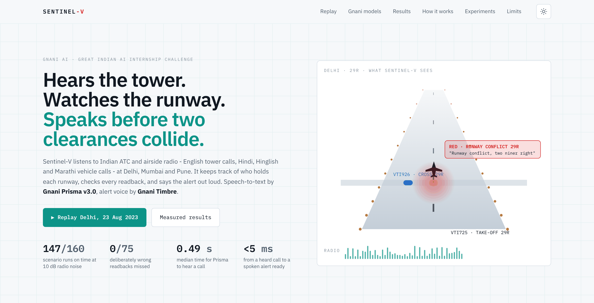
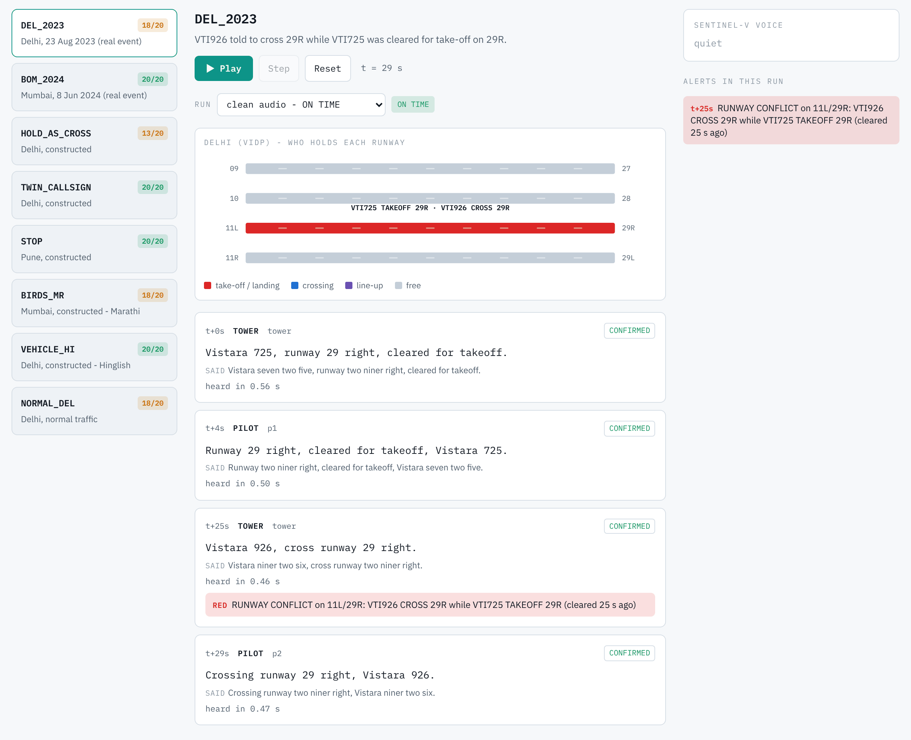
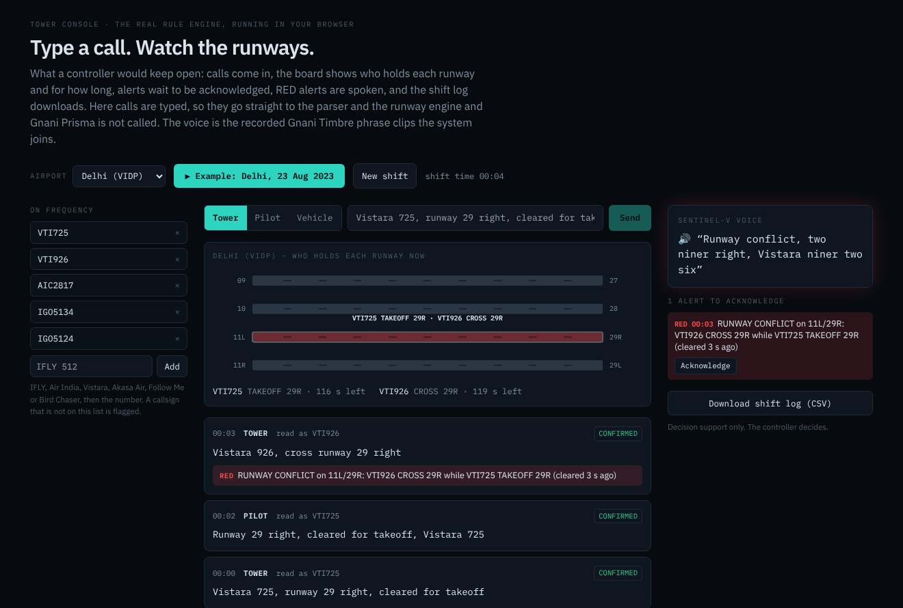
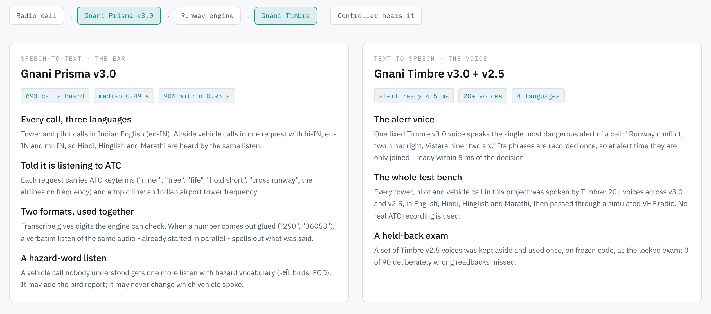
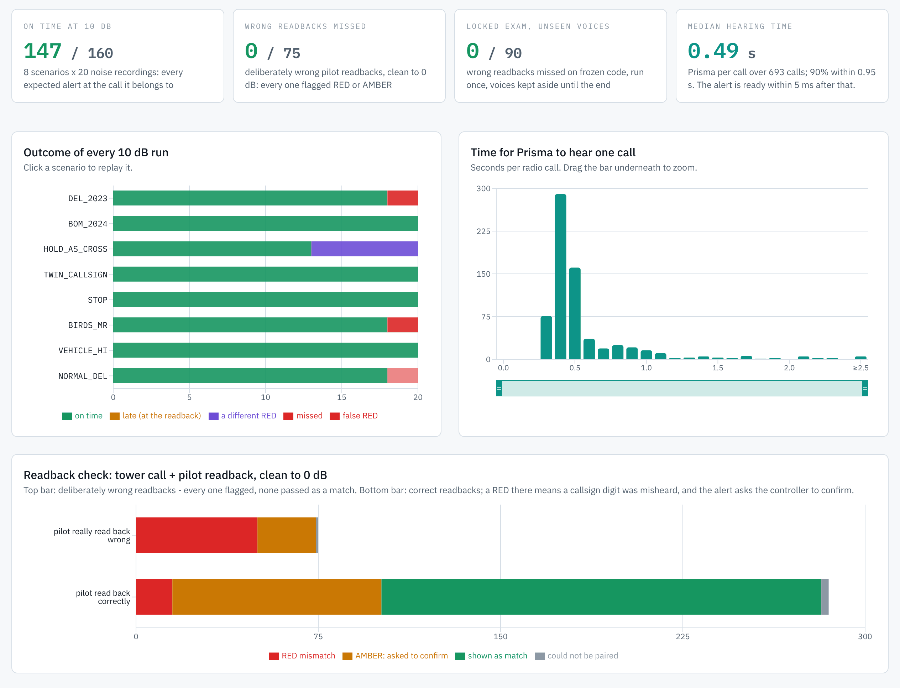
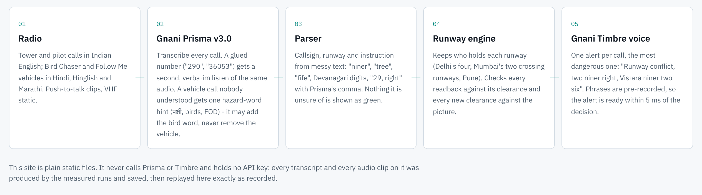

<p align="center">
  <picture>
    <source media="(prefers-color-scheme: dark)" srcset="https://raw.githubusercontent.com/Sanoer11/sentinel-v/main/docs/hero-dark.png">
    
  </picture>
</p>

<h1 align="center">Sentinel-V</h1>

<p align="center">
  <b>A second pair of ears for the control tower.</b><br>
  It hears every radio call, keeps track of every runway, and speaks up before two clearances collide.
</p>

<p align="center">
  <a href="https://sentinel-v-one.vercel.app"><b>Try&nbsp;it&nbsp;live&nbsp;›</b></a>
  &nbsp;&nbsp;&nbsp;
  <a href="https://drive.google.com/file/d/1O7jVn8HPQsFjpHMvhrUyR6kl1Y9PoPkd/view"><b>Watch&nbsp;the&nbsp;demo&nbsp;›</b></a>
  &nbsp;&nbsp;&nbsp;
  <a href="https://lnkd.in/p/ddndXZeH"><b>Watch&nbsp;the&nbsp;film&nbsp;›</b></a>
  &nbsp;&nbsp;&nbsp;
  <a href="PITCH.md"><b>Read&nbsp;the&nbsp;pitch&nbsp;›</b></a>
</p>

<p align="center">
  <a href="https://github.com/Sanoer11/sentinel-v/actions/workflows/ci.yml"></a>
</p>

<p align="center"><sub>Built on <b>Gnani Prisma v3.0</b> and <b>Gnani Timbre</b> · Delhi, Mumbai, Pune · English, Hindi, Hinglish, Marathi<br>Research prototype on synthetic voices. Decision support only, not for operational use.</sub></p>

<br>

<table>
  <tr>
    <td align="center" valign="top" width="50%"><h2>0&nbsp;/&nbsp;90</h2>wrong pilot readbacks missed in a locked exam,<br>on voices it had never heard</td>
    <td align="center" valign="top" width="50%"><h2>147&nbsp;/&nbsp;160</h2>noisy-radio scenario runs caught on time,<br>at 10&nbsp;dB (practice set)</td>
  </tr>
  <tr>
    <td align="center" valign="top" width="50%"><h2>0.49&nbsp;s</h2>median time for Gnani Prisma to hear a call,<br>over 693 calls</td>
    <td align="center" valign="top" width="50%"><h2>&lt;&nbsp;5&nbsp;ms</h2>from a heard call to a spoken alert,<br>ready to play</td>
  </tr>
</table>

<br>

## Two clearances. One runway.

On 23 August 2023 at Delhi, one Vistara aircraft was cleared to cross runway 29R and another was cleared to take off
from it. A pilot noticed, and the take-off was stopped
([ASN](https://cdn.aviation-safety.net/wikibase/344824),
[Business Standard](https://business-standard.com/amp/india-news/dgca-to-probe-runway-incursion-involving-vistara-plane-at-delhi-airport-123082300384_1.html)).

Both instructions were spoken on the radio. Nothing was listening for the clash.

**Sentinel-V listens.** It hears tower, pilot and airside radio, keeps a live picture of which aircraft holds which
runway, checks every readback against its clearance, and says the warning out loud:
*"Runway conflict, two niner right, Vistara niner two six."* When a word was not heard clearly, it asks the controller
to confirm instead of guessing.

<br>

## Every call, understood.

<p align="center">
  <picture>
    <source media="(prefers-color-scheme: dark)" srcset="https://raw.githubusercontent.com/Sanoer11/sentinel-v/main/docs/replay-dark.png">
    
  </picture>
</p>

<p align="center"><sub>The Delhi 2023 scenario, re-voiced by Gnani Timbre and played through a simulated VHF radio. Big text is what
Gnani Prisma heard; small text is what was said. The crossing clearance raises a RED runway conflict while the take-off
still holds 29R. (The replay clears the take-off first; in the real event the crossing came first. The engine catches
both orders.)</sub></p>

<br>

## Type a call. Watch the runways.

<p align="center">
  
</p>

<p align="center"><sub>The tower console on the site: what a controller would keep open. Calls come in typed, spoken or as recorded radio, the same
parser and runway engine run inside the browser, the board shows who holds each runway and for how long, alerts wait
to be acknowledged, RED alerts are spoken with the recorded Gnani Timbre phrase clips, and the shift log downloads as a
CSV. A typed call is spoken live by Gnani Timbre before it is checked, a spoken call (mic) is heard live by Gnani Prisma,
and the examples play the real recorded radio as Prisma heard it. The key stays on the site's server.</sub></p>

<br>

## Built on Gnani's speech stack.

Prisma is the ear. Timbre is the voice. Between them sits a rule-based runway engine, so the safety decision is never a
guess: the same words always give the same verdict.

<p align="center">
  <picture>
    <source media="(prefers-color-scheme: dark)" srcset="https://raw.githubusercontent.com/Sanoer11/sentinel-v/main/docs/gnani-dark.png">
    
  </picture>
</p>

| Model | What it does here |
|---|---|
| **Gnani&nbsp;Prisma&nbsp;v3.0**<br><sub>speech-to-text</sub> | Every radio call. Tower and pilots in Indian English; Hindi, Hinglish and Marathi vehicle calls in one request. ATC keyterms ("niner", "tree", "hold short") and a topic line ride along. When a runway or flight number comes out glued ("290" for "two niner"), a `verbatim` second listen of the same audio spells it out. Unclear vehicle calls get one hazard-word listen (पक्षी, birds, FOD). |
| **Gnani&nbsp;Timbre&nbsp;v3.0**<br><sub>text-to-speech</sub> | The alert voice (Devansh): phrase clips recorded ahead and joined in about 3 ms. The practice-set tower and pilot voices, and the film's narration (Shubham). |
| **Gnani&nbsp;Timbre&nbsp;v2.5**<br><sub>text-to-speech</sub> | The practice-set vehicle voices (Marathi, Hinglish), and the voices held back, unheard, for the one-time locked exam (Pranav, Kaveri, Shlok, Devika, Ishaan). |

No other speech or language model is used. The runway engine is plain Python, standard library only.

<br>

## Measured on noisy radio.

Each scenario is spoken by Timbre voices, passed through a simulated VHF radio at 10 dB signal-to-noise with 20
different noise recordings, heard by Prisma and judged by the engine. A run counts as on time only if every alert it
must raise lands at the call it belongs to.

<p align="center">
  <picture>
    <source media="(prefers-color-scheme: dark)" srcset="https://raw.githubusercontent.com/Sanoer11/sentinel-v/main/docs/results-dark.png">
    
  </picture>
</p>

| | Practice set<br><sub>tuned on, current engine</sub> | **Locked exam**<br><sub>run once, `freeze-v3`, unseen voices, new noise</sub> |
|---|---|---|
| Scenarios, clean audio | 8 / 8 on time | **7 / 8** |
| Scenarios, 10 dB radio noise | 147 / 160 on time (20 noise recordings) | **27 / 40** (5 new noise recordings) |
| False RED in normal traffic, 10 dB | 2 / 20 | **1 / 5** |
| Deliberately wrong readbacks missed | **0 / 75** | **0 / 90** |
| Correct readbacks shown RED | 15 / 285 | 13 / 300 |
| Single lines shown as fine or probable but not what was said | 0 / 864 (saved lines) | **3 / 930** (all at 5 or 0 dB; 0 at clean, 20 and 10 dB) |
| Prisma time per call (median) | 0.49 s | 0.46 s |
| Spoken alert ready after the call ends (median) | - | 0.48 s (engine 0.1 ms + voice join ~3 ms) |

<br>

## Tested like an exam. Run once.

Before the final test, the code was frozen
([`freeze-v3`](https://github.com/Sanoer11/sentinel-v/tree/freeze-v3)), a set of voices it had never heard was held
back, and the exam was run exactly once on new noise. The run is recorded in
[`testsets/ledger.json`](testsets/ledger.json), and the locked figures above stay as they came out.

Not one deliberately wrong readback was passed as correct: **0 of 90**. Not one line was shown as fine when it was not,
from clean audio down to 10 dB: **0 of 558**.

<details>
<summary><b>What the locked exam showed, and the fixes made after it (A17)</b></summary>

<br>

**What the locked exam showed.** With an unseen tower voice, Prisma often turned "two niner right" into "29, arrived"
or "290", and the airline word into digits ("35134" for "IFLY 5134"). The engine then says "confirm" (AMBER) instead
of RED - so Delhi 2023 and hold-short-as-crossing were caught on time in 0 of 5 noisy runs each, although wrong
readbacks were still never passed as correct (0 / 90). The engine was partly tuned to the practice voices; this is the
honest number: the locked figures are for `freeze-v3` and stay as they are.

**After the exam** (not in the locked numbers; judged only on practice data, never on the exam's transcripts).
The exam's voices are used up, so they were used for one more practice run (10 dB, new noise recordings 200-209).
Every remaining miss was traced to one exact cause and counted on all saved transcripts before any code (A17):

| Cause (evidence) | Fix | Result |
|---|---|---|
| "two niner right" heard as "runway 290, right" (first two digits right 61/61, side right 48/48) | read as 29R, AMBER; steps back if the second listen disagrees | 13 runs better |
| "Vistara niner two six" heard as "Tara 9026" (10/10) | undo the "niner" 0 if exactly one flight fits, AMBER | 1 better |
| crossing call with the callsign lost was AMBER "maybe the same aircraft" | an aircraft cannot cross the runway it is taking off from: RED | 2 better |
| "clear for takeoff" / "cleared to take off" not read as a take-off | both read as TAKEOFF | 1 better |
| tower callsign lost: trust the instruction anyway (Fix X) | - | **failed** (2 correct readbacks turned RED), off |

| Practice data (designed on it, so not a held-out score) | before A17 | after A17 |
|---|---|---|
| Exam voices, new noise: scenarios on time | 62 / 80 | **70 / 80** |
| Delhi 2023 with those voices | 4 / 10 | **9 / 10** |
| Earlier practice, 10 dB | 137 / 160 | **147 / 160** |
| Wrong readbacks missed | 0 | 0 |
| False RED in normal traffic | 2 / 10 and 2 / 20 | unchanged |
| Single lines shown fine but wrong (864 saved lines) | 0 | 0 |

Kept on purpose: a pilot callsign with a misheard digit that is on no flight ("Akasa Air 113") stays RED. A real
stranger taking a clearance looks exactly the same, so turning it AMBER would hide real errors.
A16 ("29, arrived" = 29R) failed its rule: only 3 calls, one voice. Off.
The held-out check for these fixes is new human audio: `python scripts/run_scenarios.py --human` (own-voice recordings,
run once on committed code, new noise 300-304).

</details>

<br>

## From a radio call to a spoken alert.

<p align="center">
  <picture>
    <source media="(prefers-color-scheme: dark)" srcset="https://raw.githubusercontent.com/Sanoer11/sentinel-v/main/docs/how-dark.png">
    
  </picture>
</p>

1. **Hear.** Radio audio goes to Gnani Prisma and comes back as text, in about half a second.
2. **Read.** Callsign, runway and instruction: cross, hold short, line up, take off, land, go around, stop, conditional
   "behind". ICAO digits ("niner", "tree", "fife") and Devanagari digits.
3. **Track.** A runway state machine knows who holds each runway, including Mumbai's two crossing runways
   (09/27 and 14/32).
4. **Check.** Every readback against its clearance: wrong runway, wrong instruction, wrong or look-alike callsign
   (IFLY 5134 vs 5124), missing STOP or hold-short confirmation. Every new clearance against the picture.
5. **Speak.** One alert per call, the most dangerous one, in a fixed Gnani Timbre voice. RED when it is sure; AMBER
   "confirm" when a word was not heard clearly.

<br>

## Seventeen experiments. Rules first.

Every fix (A1-A17) had its pass/fail rule written in its [`experiments/`](experiments/) file **before** the result was
seen, was judged on saved transcripts and fresh noise, and stayed off if it failed. Failed ideas are published too: reading
"Tara" as "Vistara" removed 17 flags but caused 2 false REDs, so it stays off. All 17 are on the
[site](https://sentinel-v-one.vercel.app/#experiments), with their verdicts.

151 engine tests and 10 site tests run on every push.

<br>

## Where it stops.

- **Radio only.** No radar or surveillance feed, so an aircraft that moves without a radio call is not seen.
- **Synthetic voices.** All speech is Gnani Timbre through a simulated radio, by design; it has not yet met live ATC audio.
- **Hold times are assumptions.** A misheard "runway vacated" keeps a runway busy (one of the 2 practice false REDs).
- **A misheard callsign digit looks like a real pilot error,** so it comes out RED "confirm callsign" on purpose.
- **The tower console is not on a live radio feed.** Calls are typed, spoken into the mic, or played from the recorded examples; the parser and engine are the real ones.

<br>

## Run it.

```
pip install -r requirements-ci.txt
python -m pytest -q tests
```

The tests need no API key; they use a fake Prisma and Timbre. For live runs:

```
pip install -r requirements.txt
python scripts/run_scenarios.py --cond clean
```

`requirements.txt` adds scipy (simulated radio) and python-dotenv (reads `.env`); Python 3.10-3.12. Put
`GNANI_API_KEY=...` in `.env`, which is never committed. ffmpeg is used for the site's mp3 export and own-voice
recordings. The site: `cd web && npm ci && npm run dev` (its data comes from `python scripts/export_web.py`).

| Path | What |
|---|---|
| `sentinel_parse.py`, `sentinel_actions.py`, `sentinel_state.py` | the engine: parsing, instructions, runway state and readback check |
| `sentinel_pipeline.py`, `gnani_client.py` | Prisma listens, Timbre, retries |
| `sentinel_voice.py` | spoken alerts |
| `scenarios.py`, `scoring.py`, `radio_sim.py` | the 8 scenarios, scoring, the simulated VHF radio |
| `scripts/` | run the scenarios, the test sets and the locked exam; export the site data |
| `experiments/` | every experiment (A1-A17), with its rule written first |
| `tests/` | the engine tests (fake Prisma and Timbre, no API key) |
| `results/`, `testsets/` | every saved run, the test sets and the exam ledger |
| `early/` | the first three days: Prisma and radio probes |
| `web/` | the public site (Next.js), deployed on Vercel; `web/public/engine/` holds copies of the engine files for the tower console (CI checks they match); `web/public/audio/voice/` holds the recorded alert phrase clips |
| `tools/` | film narration, safety hook |
| `docs/` | the screenshots in this README |

<br>

## Team

**Sanoer Soni** (B.Tech ECE, AI/ML, MIT World Peace University, Pune): speech pipeline, runway engine, experiments, site<br>
**Rudra Porwal**: security runs, research

<br>

<p align="center"><sub>Built for Gnani AI's Great Indian AI Internship Challenge · #GnaniAI #GreatIndianAIInternshipChallenge<br>
All voices are AI-generated by Gnani Timbre. The real incidents are re-voiced from public reports; no real ATC recordings
are used or published. API keys live only in <code>.env</code> (and as a server secret on Vercel); a pre-commit hook blocks keys and audio.</sub></p>
